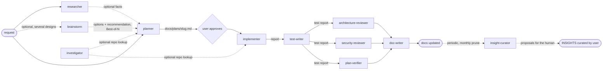

# Agents

Project subagents (`.claude/agents/*.md`), shared via version control. This file is a map of the set;
the full rules live in each agent file. Skills they use are listed at the top of each agent
file and loaded on demand with the `Skill` tool (not preloaded via `skills:`), see [../skills/README.md](../skills/README.md).

## Overview

| Agent | Responsibility | Model | Tools | Skills |
|---|---|---|---|---|
| [researcher](researcher.md) | Read-only fact finding: how the repo works, or what external docs say | sonnet | Read, Grep, Glob, Bash (read-only by prompt), WebSearch, WebFetch, AskUserQuestion | none |
| [planner](planner.md) | Turns a request into a structured Development Plan and saves it | opus | Read, Grep, Glob, **Write** (plan file only), Skill | architecture, framework, contract and security skills (13, see file) |
| [implementer](implementer.md) | Executes the plan in `client/`, `server/`, `reviewer-core/`, `mcp/`; runs typecheck and existing tests; no self-review beyond that | sonnet | Read, Grep, Glob, Edit, Write, Bash, Skill | per-layer project skills (see file) |
| [test-writer](test-writer.md) | Writes or extends tests (client, server, reviewer-core, mcp, e2e flows) at the lowest level that catches the regression; runs them and quotes output; test files only | sonnet | Read, Grep, Glob, Edit, Write, Bash, Skill | test, framework and contract skills (see file) |
| [architecture-reviewer](architecture-reviewer.md) | Read-only architecture review of a diff: runs `pnpm lint:arch` and the shared-drift check, then judges untooled rules from its catalog; every finding names a rule and `path:line` | opus | Read, Grep, Glob, Bash (limited by prompt), Skill | `onion-architecture`, `frontend-ui-architecture`, `next-best-practices`, `zod` |
| [plan-verifier](plan-verifier.md) | Read-only check of the working tree against every item of an approved plan and its spec criteria (met / partial / missing / unknown). Not the product "Plan Verifier" (roadmap L06) | opus | Read, Grep, Glob, Bash (evidence only, by prompt), Skill | `engineering-insights` (read) and plan-named skills only |
| [doc-writer](doc-writer.md) | Documents implemented features or turns plan/materials into docs with Mermaid diagrams; verifies every claim against code; documentation files only | sonnet | Read, Grep, Glob, Edit, Write, Skill (no Bash) | `mermaid-diagram`, architecture and contract skills |
| [security-reviewer](security-reviewer.md) | Read-only security review of a diff: traces untrusted input (PR content, skill imports, request bodies, LLM output) to sinks against a repo-specific rule catalog; every finding names a rule and `path:line`; no exploits | opus | Read, Grep, Glob, Bash (read-only by prompt), Skill | `security`, `fastify-best-practices`, `drizzle-orm-patterns`, `engineering-insights` (read) |

| [brainstorm](brainstorm.md) | Read-only option generator before planning: 3 genuinely different designs with repo evidence, weighted comparison, one recommendation; writes nothing. Can run as Best-of-N in parallel | opus | Read, Grep, Glob, Skill | `engineering-insights` (read) and layer skills to judge fit (see file) |
| [investigator](investigator.md) | Read-only codebase lookup for narrow "search and trace" questions about this repo only (definitions, usages, import chains, impact of a change); no web, never asks the user, no fixes | sonnet | Read, Grep, Glob, Bash (read-only by prompt) | none |
| [insight-curator](insight-curator.md) | Read-only helper for the monthly `INSIGHTS*.md` prune: finds duplicates, contradictions and stale entries, proposes keep / merge / prune / promote with exact line text | sonnet | Read, Grep, Glob, Skill | `engineering-insights` (read) |

The implementer does no review beyond its own typecheck and tests. Architecture review is owned by
`architecture-reviewer`, plan coverage by `plan-verifier`. **Security review** is owned by
`security-reviewer` (the implementer hands off areas to look at).

## Workflow

The main session chains the agents (none can spawn another). `plan-verifier` runs after `test-writer`
so the new tests count as evidence; `architecture-reviewer`, `security-reviewer` and `plan-verifier` are independent and
can run in parallel. `brainstorm`, `investigator` and `insight-curator` are optional helpers outside the
main chain: `brainstorm` runs before `planner` when the design choice matters (several instances can run in
parallel as Best-of-N and be compared); `investigator` answers a narrow repo-only lookup for the planner or
implementer (unlike `researcher`, it has no web tools and does not interview the user); `insight-curator`
runs periodically or at the end of a cycle (monthly prune) and only proposes changes. Subagents start with a fresh context, so the delegating prompt must give each
agent the plan path and the previous agents' reports (they are claims for the verifier, not evidence).

## Token budget

Measured on the Intent Layer run: ~650k subagent tokens, of which ~29% went to a planner run that hit its turn
limit before writing the plan, and the same typecheck / `lint:arch` / test commands ran in three agents.
Conventions that cut this without dropping a check:

- **One check runner.** `scripts/verify.sh` runs typecheck, `lint:arch`, tests and shared drift for the touched
  modules and caches the result per working-tree fingerprint (`.verify/<hash>/`, git-ignored). The implementer
  runs it last; `architecture-reviewer` reuses it (`--checks lint,drift`); `plan-verifier` runs it once with
  `--force` as the single independent final gate (that run is what exposed the flaky ITs, so keep it).
- **Context pack.** Before launching the reviewers, run `scripts/context-pack.sh --plan docs/plans/<slug>.md` and put
  the printed path in both prompts. It holds the changed-file list, one filtered `change.diff` (no lock files or
  migration snapshots) and the verify summary, so reviewers read hunks by line range instead of each running
  `git diff` and opening whole files.
- **Short reports.** `plan-verifier` lists only non-`met` items as full rows and `met` items as one line each.
  Ask every agent for findings and gaps, not a restatement of what passed.
- **Review only when it can find something.** Run `architecture-reviewer` when the diff adds a module, port,
  adapter, route or shared contract; otherwise `verify.sh --checks lint,drift` already covers the tooled rules.
  `plan-verifier` runs after every implementation.
- **Fix rounds go back to the same agent** via `SendMessage` (its context is warm: ~13k tokens for a four-fix
  round versus a cold ~200k run), not to a new agent.
- **Planner:** give it the files to read and expect a skeleton plan file early (see its Process step 3).
- **Models:** mechanical agents (`implementer`, `doc-writer`, `test-writer`, `researcher`) are already `sonnet`;
  judgement agents (`planner`, `architecture-reviewer`, `plan-verifier`, `brainstorm`) stay `opus`. Change a
  model only after a run shows the cheaper one missing findings.
- Prompt caching works inside one agent's loop; it is not shared between different agent types, so the saving
  between agents comes from smaller, identical inputs (the pack), not from cache hits.

## Artifacts

| Agent | Input | Output |
|---|---|---|
| researcher | A concrete question (repo or external); if vague, it interviews the user | Chat report: summary, findings with evidence, sources, "Not found" (format in the agent file) |
| planner | Request; module `INSIGHTS.md`, `specs/`, `docs/`, `README.md`, code | `docs/plans/<slug>.md` (Development Plan, `Status: draft`) and a short reply with the path |
| implementer | Approved plan path; `INSIGHTS.md` of the folder it works in (read before the first edit there); matching skills | Code and test changes in the working tree; Implementation Report (status, steps, skills applied, verification table, deviations, reviewer handoff, insight candidates) |
| test-writer | Plan path or scope; implementer report; module `INSIGHTS.md`, `TESTING.md` | New or extended test files; Test Report (scope, tests added with the regression each catches, verification table, not unit-testable, production bugs found, insight candidates) |
| architecture-reviewer | Diff or scope; module `INSIGHTS.md` | Chat report: verdict `pass` / `pass-with-warnings` / `fail`, checks run, findings `A<n>` (rule id, severity, new or pre-existing, `path:line`, evidence, fix direction), pre-existing baseline, not statically checkable, observations |
| plan-verifier | Approved plan path (and its spec); implementer and test-writer reports as claims | Chat report: verdict `verified` / `not verified` / `inconclusive`, traceability table per plan item, test integrity, untraced changes, commands run, unknowns |
| doc-writer | Implemented feature, plan, spec draft or notes; the code | Doc files in the right place (`<module>/specs/`, `<module>/docs/`, README, `TESTING.md`); Doc Report (files written, claims verified with `path:line`, contradictions, proposed links, insight candidates) |
| brainstorm | Request with several plausible designs; module `INSIGHTS.md`, `specs/`, `docs/`, code | Chat report: 3 options with repo evidence, weighted comparison, one recommendation (no files) |
| investigator | A concrete repo question (optional scope, start symbols) | Chat report: Found / Not found / Unverified, every claim with `path:line`; no fixes or advice |
| insight-curator | Request to prune or review insights; root and module `INSIGHTS*.md`, cited files | Chat proposal list: exact line text, action keep / merge / prune / promote, reason (no edits) |

## Permissions

- **researcher** cannot write files (no `Write`/`Edit`). `Bash` is limited to read-only commands by its prompt, not by the harness.
- **planner** has no `Bash`, so it cannot run commands. `Write` is granted only to save `docs/plans/<slug>.md`; this limit is enforced by its prompt, not by the harness. It never writes code, specs, `INSIGHTS*.md` or config.
- **implementer** has `Edit`/`Write`/`Bash` but no `Agent` and no web tools. Its prompt forbids: editing applied migrations and lock files, `docker compose down -v`, reading secrets, git writes (`commit`, `push`, `pull`, `checkout`, `reset`, `stash`), and writing `INSIGHTS*.md`.
- **test-writer** has `Edit`/`Write`/`Bash`. Write scope (by prompt): `server/test/**`, `client/src/**/*.test.{ts,tsx}`, `reviewer-core/test/**`, `mcp/test/**`, `e2e/specs/*.flow.json`, and new doubles appended to `server/src/adapters/mocks.ts` (always reported). It never edits production code (a bug is reported as "Production bug found" with the failing test kept) and never deletes, skips or weakens tests.
- **architecture-reviewer** and **plan-verifier** are read-only: no `Edit`/`Write`. Their `Bash` is limited by prompt (reviewer: `pnpm lint:arch`, `scripts/check-shared-drift.sh`, read-only git, `rg`; verifier: the plan's verification commands, typecheck/test/`lint:arch` scripts, read-only git).
- **doc-writer** has `Edit`/`Write` but no `Bash`, so it cannot run commands. Its prompt forbids code, tests, plans, `INSIGHTS*.md`, `AGENTS.md`/`CLAUDE.md`, `.claude/**`, `docs/skills/**`, `docs/agent-prompts/**`, `docs/research/**` and `docs/plans/**`; it proposes "Read When" link lines in its report instead.
- **brainstorm**, **investigator** and **insight-curator** have no `Edit`/`Write`. The investigator's `Bash` is limited to read-only commands by its prompt, not by the harness; brainstorm and insight-curator have no `Bash`. The insight-curator never writes `INSIGHTS*.md` (they are append-only and the `engineering-insights` hook blocks edits); it proposes curation (keep / merge / prune / promote) for the user or main session to apply.
- No agent has the `Agent` tool, so none of them can spawn subagents.
- Prompt-level limits are a convention. To enforce them mechanically (test-writer/doc-writer path scopes, write-like Bash for the two read-only agents), add a `PreToolUse` hook in `.claude/settings.json` (not done yet; open decision D-hook, see [../../docs/plans/workflow-review-agents.md](../../docs/plans/workflow-review-agents.md)).

## Plan file convention

`docs/plans/<slug>.md`, `kebab-case` slug. Header carries `Status: draft | approved`; the planner
always writes `draft`, and the user approves. Sections: Goal and non-goals, Constraints applied,
Skills for implementer, Steps, Contract / migration impact, Tests and verification, Left to other
agents, Risks and open questions. The skill routing table in `planner.md` mirrors
[../skills/pr-self-review/skill-map.json](../skills/pr-self-review/skill-map.json); change both together.

## Sources behind the rules

### planner

| Rule | Basis |
|---|---|
| Only `name` and `description` required; one focused task per agent; distinct delegation trigger ("use proactively", "executes an approved plan") | [Subagents docs](https://code.claude.com/docs/en/sub-agents) |
| Least-privilege `tools` allowlist; read-only tool set plus a single narrow `Write` | [Subagents docs](https://code.claude.com/docs/en/sub-agents) (code-reviewer example); a subagent's `permissionMode` is overridden by a permissive parent session, so tools are the real guard |
| No `Agent` tool, so no nested subagents | [Subagents docs](https://code.claude.com/docs/en/sub-agents) (nesting is on by default; omit `Agent` to stop it) |
| Plan is a saved file, not a pasted blob, because subagents lose context and large outputs lose information when copied through the coordinator | [Multi-agent research system](https://www.anthropic.com/engineering/multi-agent-research-system) |
| Plan, validate, then execute with a structured plan file | [Skill best practices](https://platform.claude.com/docs/en/agents-and-tools/agent-skills/best-practices) (plan-validate-execute) |
| Objective, output format, tool guidance, task boundaries, stop conditions in the prompt | [Multi-agent research system](https://www.anthropic.com/engineering/multi-agent-research-system) |
| Skills loaded on demand, not preloaded (`skills:` injects full text of every listed skill) | [Subagents docs](https://code.claude.com/docs/en/sub-agents), [Skills docs](https://code.claude.com/docs/en/skills) (progressive disclosure) |
| Read module `INSIGHTS.md`, specs and docs before planning; spec first if missing | project rules: [../../AGENTS.md](../../AGENTS.md) "Documentation loop" |

### implementer

| Rule | Basis |
|---|---|
| Write-capable tool set without `Agent` or web; `maxTurns` as a mechanical cap | [Subagents docs](https://code.claude.com/docs/en/sub-agents) (debugger example, `maxTurns`) |
| Takes the plan path explicitly (fresh context, no conversation history) | [Subagents docs](https://code.claude.com/docs/en/sub-agents) (context isolation) |
| Stop conditions and a bounded effort instead of open-ended retries | [Multi-agent research system](https://www.anthropic.com/engineering/multi-agent-research-system) (unbounded effort as a failure mode) |
| Structured report with real command output; no claimed passes | [Writing tools for agents](https://www.anthropic.com/engineering/writing-tools-for-agents) (high-signal, actionable output) |
| Per-layer skills loaded on demand, descriptions as triggers | [Skills docs](https://code.claude.com/docs/en/skills), [Skill best practices](https://platform.claude.com/docs/en/agents-and-tools/agent-skills/best-practices) |
| Only self-check: code written, existing tests and typecheck pass; all review is separate | user decision (no official guidance, per the research) |
| Hard constraints (migrations, lock files, secrets, `down -v`, git writes, outbound calls) | project rules: [../../AGENTS.md](../../AGENTS.md) "Do not touch", "Gotchas" |

### test-writer

| Rule | Basis |
|---|---|
| Lowest pyramid level that catches the regression | [Practical test pyramid](https://martinfowler.com/articles/practical-test-pyramid.html) |
| RTL query priority (role first, test id last); no implementation-detail tests | [Testing Library queries](https://testing-library.com/docs/queries/about/#priority), [Testing implementation details](https://kentcdodds.com/blog/testing-implementation-details) |
| Async Server Components are not unit-testable, so they go to e2e | [Next.js Vitest guide](https://nextjs.org/docs/15/app/guides/testing/vitest) |
| Server hermetic tests use `buildApp()` + `inject`, then `close()` | [Fastify testing guide](https://fastify.dev/docs/latest/Guides/Testing/) |
| Write-capable tool set without `Agent`; real command output in the report | [Subagents docs](https://code.claude.com/docs/en/sub-agents), [Writing tools for agents](https://www.anthropic.com/engineering/writing-tools-for-agents) |
| Self-check against the product test-quality rubric | project: [../../docs/agent-prompts/test-quality-reviewer.md](../../docs/agent-prompts/test-quality-reviewer.md), `docs/skills/{uncovered-branches,missing-corner-cases,over-mocking,flaky-tests}` |
| Drizzle/Postgres test setup | no external source; the repo's `server/test/helpers/pg.ts` pattern |

### architecture-reviewer

| Rule | Basis |
|---|---|
| Deterministic checks first, judgement only for untooled rules; rules are named and machine-checkable where possible | [dependency-cruiser rules reference](https://github.com/sverweij/dependency-cruiser/blob/main/doc/rules-reference.md), [ArchUnit user guide](https://www.archunit.org/userguide/html/000_Index.html), *Building Evolutionary Architectures* ch. 2 (fitness functions) |
| Report only high-signal, evidenced findings; skip linter-catchable and nitpick items | [Claude Code code-review plugin](https://github.com/anthropics/claude-code/blob/main/plugins/code-review/commands/code-review.md) |
| Read-only tool set, no `Agent` | [Subagents docs](https://code.claude.com/docs/en/sub-agents) (code-reviewer example) |
| Rule catalog: the 11 rules in `server/.dependency-cruiser.cjs`, server and client conventions, `shared-drift` | project: `server/.dependency-cruiser.cjs`, [../../AGENTS.md](../../AGENTS.md), module `docs/` and `INSIGHTS.md` |

### plan-verifier

| Rule | Basis |
|---|---|
| Evidence beats claims: grade against files, commands and tests, not against the implementer's report | [Effective harnesses for long-running agents](https://www.anthropic.com/engineering/effective-harnesses-for-long-running-agents), [Demystifying evals for AI agents](https://www.anthropic.com/engineering/demystifying-evals-for-ai-agents) |
| Deterministic graders first, judgement second, "unknown" instead of guessing | [Demystifying evals for AI agents](https://www.anthropic.com/engineering/demystifying-evals-for-ai-agents), [LLM-as-a-judge (arXiv 2306.05685)](https://arxiv.org/abs/2306.05685) (judge biases) |
| Read-only tool set, no `Agent` | [Subagents docs](https://code.claude.com/docs/en/sub-agents) |

### doc-writer

| Rule | Basis |
|---|---|
| Pick the doc type (reference, how-it-works, explanation, tutorial) before writing | [Diataxis](https://diataxis.fr) |
| Docs live next to code and are versioned and reviewed like code | [Docs as code](https://www.writethedocs.org/guide/docs-as-code/) |
| GitHub-renderable Mermaid, one flow or one C4 level per diagram | [GitHub: creating diagrams](https://docs.github.com/en/get-started/writing-on-github/working-with-advanced-formatting/creating-diagrams), [C4 model](https://c4model.com) |
| Real decisions recorded with context and consequences | [MADR](https://adr.github.io/madr/) (we use a "Decision" section in the spec) |
| No `Bash`, no `Agent`; documents only what it verified in code | [Subagents docs](https://code.claude.com/docs/en/sub-agents); project: [../../AGENTS.md](../../AGENTS.md) "Documentation loop" |

### Not backed by official guidance

No official planner→implementer schema exists; the plan format and `docs/plans/` location are our
convention. Whether `permissionMode: plan` hard-enforces read-only for subagents was not confirmed,
so it is not used.

The four workflow agents (test-writer, architecture-reviewer, plan-verifier, doc-writer) add these
project conventions that no official source backs:

- The plan-verifier verdict scale (`verified` / `not verified` / `inconclusive`) and item status scale (`met` / `partial` / `missing` / `unknown`) are our own synthesis.
- The architecture-reviewer verdict scale and the client rule ids (`ui-layering`, thin page, `_components`, barrels, `'use client'` placement); client findings are judgement-only (no client `lint:arch`), capped at medium confidence.
- The doc-writer destination map (which doc type goes to which file).
- The agent order (test-writer before the reviewers, doc-writer last) and the parallel run of architecture-reviewer and plan-verifier.
- The three helpers (brainstorm, investigator, insight-curator) are backed only by the course slide "Our agent set: helpers", with no official source: their roles, the Best-of-N use of brainstorm, the brainstorm/investigator vs planner/researcher split, and the proposal-only curation flow are our convention.
- "Failing test first" as a rule for the test-writer has no source; the hook-based enforcement (D-hook) is untested.
