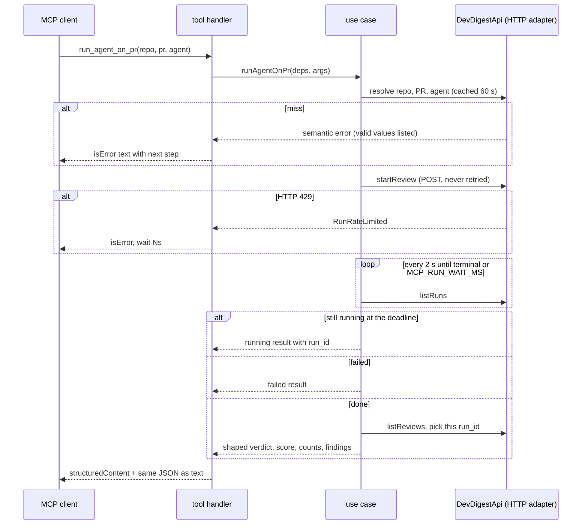

# mcp — design

How `@devdigest/mcp` is built. What it must do lives in [../specs/mcp-server.md](../specs/mcp-server.md); the plan in [../../docs/plans/mcp-server.md](../../docs/plans/mcp-server.md). Claims carry `path:line` (paths relative to `mcp/`).

## Flow of `run_agent_on_pr`

- Resolve, start, poll, fetch reviews, shape: `src/use-cases/run-agent-on-pr.ts:34-81`.
- The POST is never retried, a second one would start and bill a second run: `src/use-cases/run-agent-on-pr.ts:40`, `src/ports.ts:34`.
- Poll interval 2 s, wait budget 100 s (`MCP_RUN_WAIT_MS`): `src/constants.ts:32-33`, `src/config.ts:53-63`.
- A run not listed yet counts as running: `src/use-cases/run-agent-on-pr.ts:70`.
- Lost `run_id`: once `startReview` succeeded, an `ApiUnreachable`/`ApiError` from `listRuns` or `listReviews` returns the `running` result (with `run_id` and the `get_findings` call) instead of throwing, so the model does not start a second billed run; a failing `startReview` stays an error: `src/use-cases/run-agent-on-pr.ts:43-52`.
- Success returns `structuredContent` plus identical JSON text; semantic errors become `isError:true`: `src/tools/result.ts:5-19`.
- Error wording lives only in `src/tools/to-tool-error.ts:20-71`; unknown errors give a generic text and only the class name goes to stderr (`:69-70`). The `ApiUnreachable` text shows only the origin (`originOf`, `src/shape/text.ts:20-28`); `AgentNotFound` names are capped (`:35-38`).
- Each API call times out after 10 s and a network failure becomes `ApiUnreachable`: `src/api/http-devdigest-api.ts:27`, `:235-259`.
- Redirects are never followed: every request uses `redirect: 'error'`, so a 3xx cannot re-send the request (or the `POST` body) to another host: `src/api/http-devdigest-api.ts:250`. The error carries the origin of the base only: `:254`.
- Untrusted text is capped (`TEXT_CAPS`: agent name/description, finding file, convention category/evidence path, plus the older title/rationale/suggestion/rule/error caps): `src/constants.ts:10-23`, applied in `src/shape/agents.ts`, `findings.ts`, `conventions.ts`. `list_agents` is also kept under the response cap (`fitToBudget`): `src/shape/agents.ts:21`.
- One response is capped at 20 000 characters: `src/constants.ts:21`, `src/shape/budget.ts`.

## Rings

Dependencies point inward only. No tool enforces this except `test/layering.test.ts` (`pnpm lint:arch` covers only `server/` and `reviewer-core/`).

| Ring | Files | May import | Must not import |
|---|---|---|---|
| 1 Domain | `src/shape/`, `src/errors.ts`, `src/constants.ts` | nothing outside the ring | everything else |
| 2 Application | `src/ports.ts`, `src/resolve.ts`, `src/use-cases/` (ports, `Deps`, `Clock`) | ring 1 | `node:`, the SDK, `fetch`, `process`, `src/api/`, `src/tools/`, `config.ts` |
| 3 Adapter | `src/api/http-devdigest-api.ts` (REST client, tolerant Zod schemas, HTTP status to semantic errors) | rings 1-2, `fetch` | `src/tools/`, the SDK |
| 4 Edge | `src/tools/` (thin handlers, error catalog), `src/server.ts` (`McpServer`, frozen instructions) | rings 1-2, the SDK | `src/api/` |
| 5 Composition | `src/index.ts`, `src/config.ts` (env, base URL rules, loopback guard) | everything | |

- Inner rings checked by the layering test: `test/layering.test.ts:12-33`.
- Composition root builds the adapter, `Deps` and server, owns `process` and signals: `src/index.ts:24-48`.
- The port is declared by the application ring, the adapter implements it: `src/ports.ts:27-42`.
- Tools register in a fixed order: `src/tools/index.ts:13-28`. `tools.listChanged` is false: `src/server.ts:17`.
- `stdout` carries protocol only, logs go to stderr: `src/index.ts:15-17`.
- Base URL rules: a non-loopback base is refused unless `DEVDIGEST_ALLOW_REMOTE=1` (`src/config.ts:11`, `:29-31`); independently, the base must be plain `http(s)` with no username, password, query or hash (`src/config.ts:37-51`). The startup log shows only the origin: `src/index.ts:48`.
- The package does not import `@devdigest/shared`; it declares small tolerant schemas for the fields it reads (`AGENTS.md` Conventions, `src/api/http-devdigest-api.ts`).
